# Codyssey Mission 2 - Python Quiz Game

## 1. 프로젝트 개요

Python으로 개발한 터미널 기반 4지선다 퀴즈 게임입니다.

사용자는 퀴즈를 풀거나 새로운 문제를 등록할 수 있으며,
퀴즈 목록과 최고 점수를 확인할 수 있습니다.

퀴즈 데이터와 최고 점수는 JSON 파일에 저장되어
프로그램을 종료한 후 다시 실행해도 유지됩니다.

## 2. 퀴즈 주제 및 선정 이유

**주제: Python 기초 및 개발 도구**

Codyssey에서 학습한 Python, Git, Docker 개념을
복습하기 위해 이 주제를 선정했습니다.

퀴즈 게임을 직접 개발하면서 Python 문법과 객체지향 프로그래밍,
파일 입출력, Git 버전 관리 방법을 학습하는 것이 목표입니다.

## 3. 개발 환경

- OS: Ubuntu (WSL)
- Python: 3.14.4
- IDE: Visual Studio Code
- Version Control: Git / GitHub
- 외부 라이브러리: 없음 (Python 표준 라이브러리 사용)

## 4. 실행 방법

Python 3.10 이상이 필요합니다.

프로젝트 폴더에서 다음 명령어를 실행합니다.

```bash
python3 main.py
```

프로그램 실행 후 메뉴 번호를 입력하여 기능을 선택합니다.

## 5. 주요 기능

| 메뉴 | 기능 | 설명 |
|---|---|---|
| 1 | 퀴즈 풀기 | 문제 출제, 정답 판정 및 점수 계산 |
| 2 | 퀴즈 추가 | 문제, 선택지 4개, 정답 등록 |
| 3 | 퀴즈 목록 | 등록된 문제 목록 확인 |
| 4 | 점수 확인 | 최고 점수 확인 |
| 5 | 종료 | 데이터 저장 후 프로그램 종료 |

### 추가 구현 사항

- 기본 퀴즈 5개 제공
- 잘못된 입력 처리 및 재입력 안내
- Ctrl+C 및 EOFError 처리
- UTF-8 인코딩 검사
- JSON 파일 저장 및 불러오기
- JSON 파일 손상 시 기본 퀴즈로 초기화
- 임시 파일을 이용한 안전한 데이터 저장

## 6. 프로젝트 파일 구조

```text
codyssey_1-2/
├── main.py              # 프로그램 시작
├── quiz.py              # Quiz 클래스
├── quiz_game.py         # QuizGame 클래스
├── quiz_data.py         # 기본 퀴즈 5개
├── state.json           # 퀴즈 데이터 및 최고 점수
├── README.md            # 프로젝트 설명서
├── .gitignore           # Git 추적 제외 설정
└── docs/
    └── screenshots/
        ├── 01-environment.png
        ├── 02-menu.png
        ├── 03-play.png
        ├── 04-add_quiz.png
        ├── 05-quiz_list.png
        ├── 06-best_score.png
        ├── 07-json.png
        ├── 08-git_log.png
        └── 09-error_handling.png
```

## 7. 데이터 파일 설명

데이터는 프로젝트 루트의 `state.json` 파일에 UTF-8 형식으로 저장됩니다.

### JSON 데이터 구조

```json
{
    "quizzes": [
        {
            "question": "Python에서 화면에 글자를 출력하는 함수는?",
            "choices": [
                "input()",
                "print()",
                "open()",
                "return()"
            ],
            "answer": 2
        }
    ],
    "best_score": 80
}
```

| 필드 | 설명 |
|---|---|
| quizzes | 등록된 퀴즈 목록 |
| question | 퀴즈 문제 |
| choices | 4개의 선택지 |
| answer | 정답 번호 (1~4) |
| best_score | 최고 점수 (0~100점, 기록이 없으면 null) |

파일이 없으면 기본 퀴즈를 사용합니다.

파일이 손상되었을 경우 오류 메시지를 표시하고
기본 퀴즈 데이터로 초기화합니다.

## 8. Git 버전 관리

- 기능 단위로 커밋 작성
- `feature/quiz-play` 브랜치에서 퀴즈 풀기 기능 개발
- `main` 브랜치로 병합
- GitHub 원격 저장소에 변경사항 업로드
- `git clone` 및 `git pull` 실습

### GitHub Repository

https://github.com/glocaledu/codyssey_1-2

## 9. 실행 화면

### 개발 환경

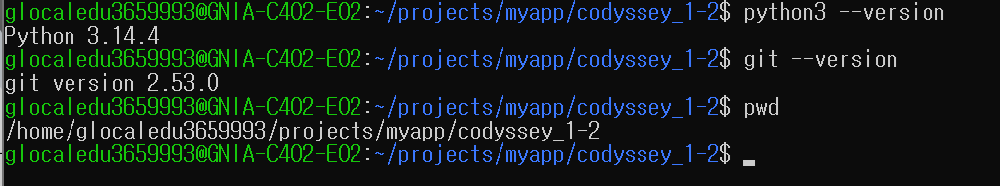

### 메인 메뉴

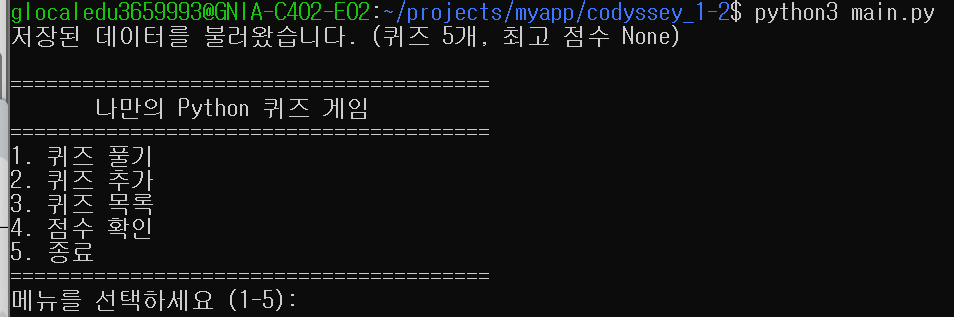

### 퀴즈 풀기

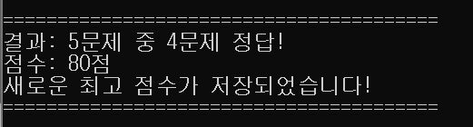

### 퀴즈 추가

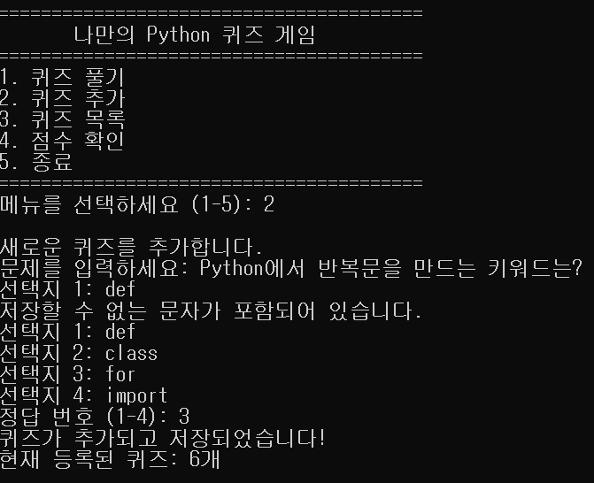

### 퀴즈 목록

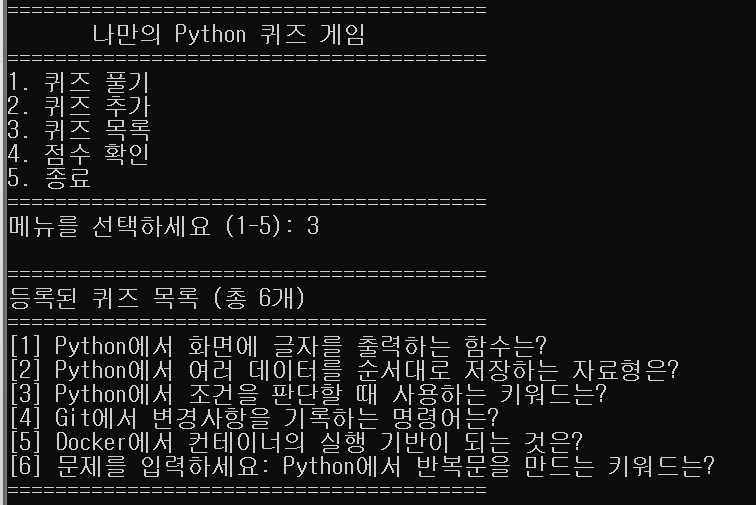

### 최고 점수

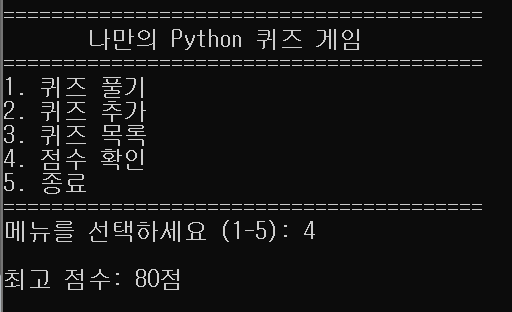

### JSON 데이터 저장

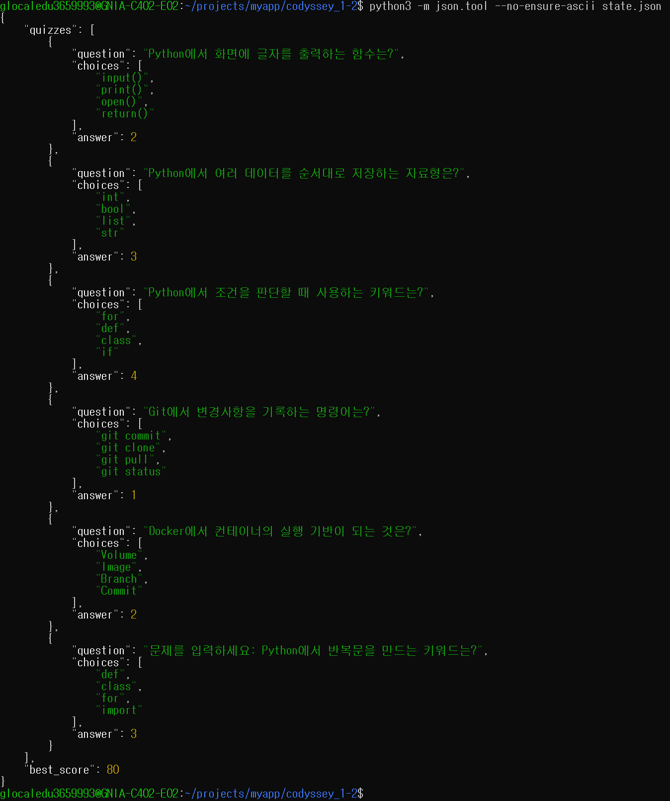

### Git 커밋 및 브랜치 기록

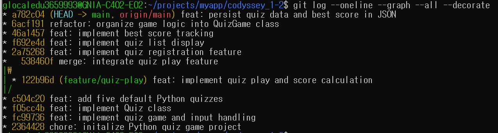

### JSON 오류 처리

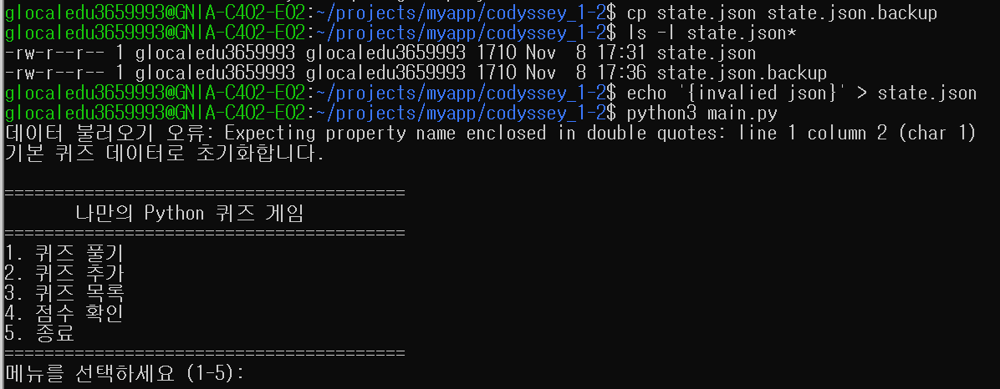

### Git Clone 실습

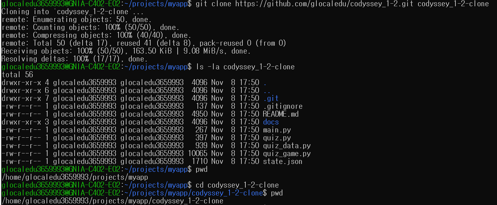

### Git Pull 실습

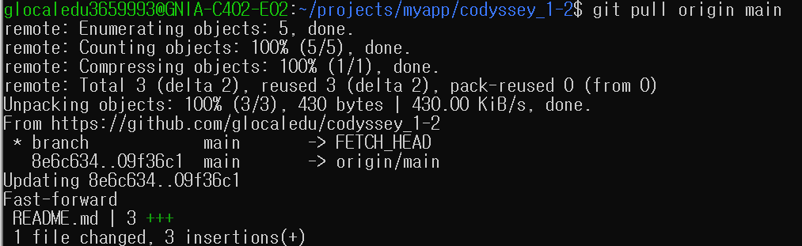

## 10. 학습 내용

이번 프로젝트를 통해 다음 내용을 학습했습니다.

- Python 변수, 자료형, 조건문, 반복문, 함수
- 클래스와 객체, `__init__`, `self`
- 리스트 및 딕셔너리를 활용한 데이터 관리
- JSON 파일 읽기와 쓰기
- try/except를 이용한 예외 처리
- Git 커밋, 브랜치 생성 및 병합
- GitHub를 활용한 코드 관리
```

## Git Clone & Pull 실습
GitHub 저장소를 clone하고, 복제본에서 수정한 내용을 원본 저장소에 반영하는 실습을 완료했습니다.
